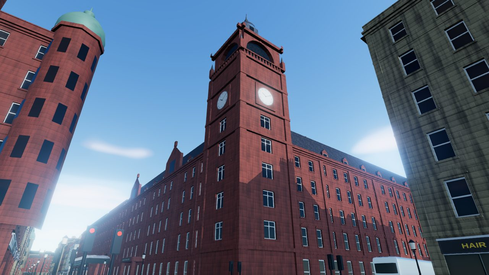
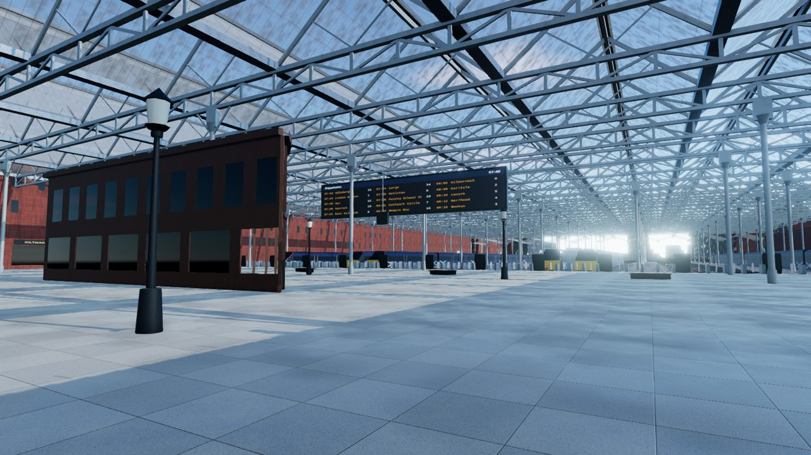
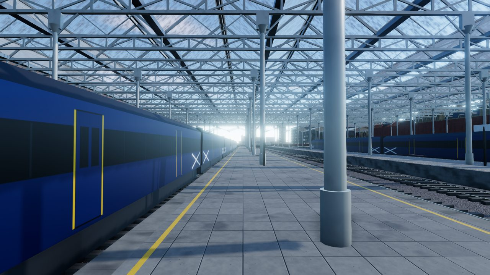
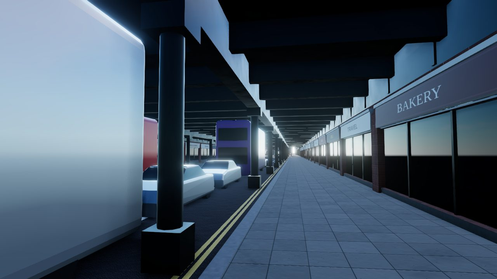
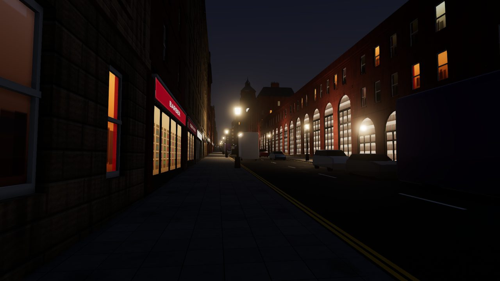
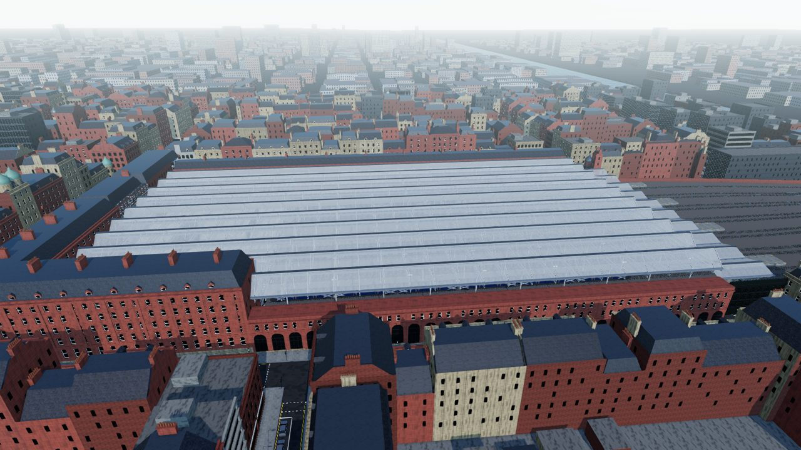
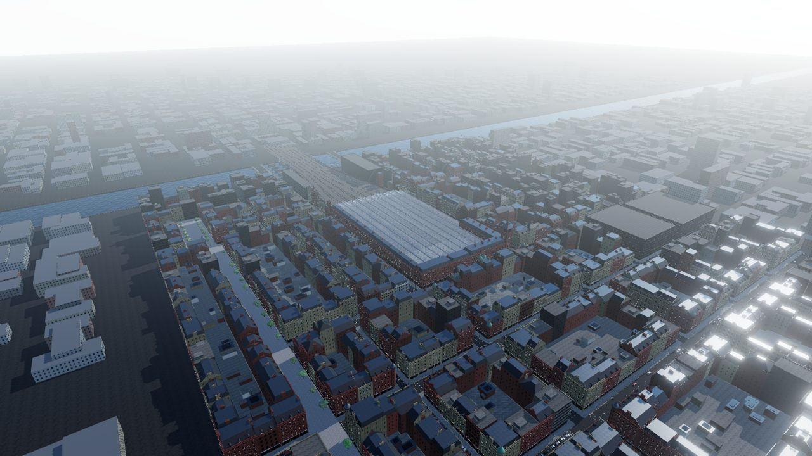

# Glasgow Central in 3D

A real-time 3D model of central Glasgow that runs in the browser. It starts with **Glasgow Central
Station** and extends to the streets and buildings around it, from West George Street down to the
River Clyde.



| | |
|---|---|
|  |  |
|  |  |
|  |  |

## Running it

```bash
npm install
npm run dev        # http://localhost:5173
npm run build      # static site in dist/ (hostable anywhere)
```

Everything is generated in the browser at load time: geometry, the PBR textures (sandstone, slate,
granite, asphalt, paving, glazing), signage and lighting. There are no external assets to download.

### Controls

| Input | Action |
|---|---|
| Drag / right-drag / scroll | Orbit / pan / zoom |
| View buttons | Fly to preset viewpoints |
| `F` | Walk at street level (WASD, Shift to run, mouse to look) |
| `H` | Hide the panel |
| Time / Month / Weather | Real solar position for Glasgow; clear, hazy, "Glasgow grey" overcast and night |

URL parameters: `?view=concourse&time=21.5&month=12&weather=night&quality=fast`.

## What is modelled

**Glasgow Central Station** (`src/landmarks/centralStation.js`)
- **Central Hotel**: red sandstone Gordon Street and Hope Street wings with a mansard roof, dormers,
  Dutch gables, chimney stacks, the hotel porch, and the **clock tower** with its belfry, pinnacles,
  lead roof and lantern.
- **Gordon Street entrance**: three great arches and the glazed canopy carrying the
  *CENTRAL STATION* lettering.
- **Station offices** on the corner of Gordon Street and Union Street, and the long **Union Street
  frontage**. It steps down the slope towards Argyle Street and has its entrance arch.
- **Hope Street**: the arcaded screen wall stepping down the hill.
- **Concourse**: terrazzo floor, the curved timber information building, departure boards, a hanging
  clock, the gateline, benches, concourse shops and lamps.
- **Train shed**: a ridge-and-furrow glazed roof on lattice girders and cast-iron columns, 15 platform
  faces, 14 tracks with rails, sleepers, ballast and buffer stops, and trains standing at the
  platforms.
- **The Hielanman's Umbrella**: the glass-walled railway bridge over Argyle Street, with its
  shopfronts, columns and deck girders underneath.
- The **viaduct** to the river, with blind arches and openings over Midland Street and the Broomielaw.
  Also the **Caledonian Railway Bridge** across the Clyde, and the granite piers of the original 1878
  bridge beside it.

**Surrounding city** (`src/city/`)
- The street grid: Hope St, Union/Renfield St, Jamaica St, Oswald St, Wellington/Robertson St,
  West Campbell/York St, West Nile St, Mitchell St, Buchanan St (pedestrianised), Gordon/Bothwell St,
  St Vincent St, West George St, West Regent St, Waterloo St, Argyle St, Midland St, Howard St and the
  Broomielaw/Clyde St quays.
- Terrain that falls from Blythswood Hill to the Clyde. Argyle Street really does run about 7 m below
  the station deck.
- Procedural Victorian and Edwardian sandstone blocks, in red Locharbriggs and blond Giffnock-style
  stone with soot weathering. They have recessed sash windows, shopfronts with fascias, cornices,
  string courses, pediments, mansard and pitched slate roofs with dormers and chimney pots, corner
  turrets with domes, and back-court outbuildings. Towards the Broomielaw and Bothwell St there is
  warehouse, 1970s and glass-office infill.
- Recognisable neighbours: the **Ca' d'Oro** at Gordon St/Union St and the **Grosvenor Building**
  opposite the station entrance (`src/landmarks/neighbours.js`).
- Streets: kerbs, granite kerbstones, paving flags, double yellow lines, stop lines, signal crossings,
  bus lanes, traffic signals, street lights (heritage lanterns around the station), trees, cars, black
  cabs and buses.
- The River Clyde with quay walls and railings, **Glasgow Bridge** and **King George V Bridge**, and a
  lower-detail surrounding city out to the horizon.

**Rendering** (`src/engine/`, `src/materials/`): physically based materials, a Preetham sky with the
correct sun position for 55.86°N, sky-derived image-based lighting, a sun shadow map that follows
the camera, ground-truth ambient occlusion (GTAO), bloom, ACES tone mapping and SMAA. At night,
window glass shows lit room and shop interiors, and a pool of real point lights follows the camera
through the street lamps and station floodlights.

## Accuracy and real map data

This environment had no access to map services, so the street layout and the station were
hand-authored from knowledge of the area. Positions are close but approximate, and the buildings
around the station are procedural stand-ins in the local architectural style. They are not surveyed
copies of individual buildings.

To use real building footprints from OpenStreetMap:

```bash
npm run fetch-osm            # 700 m radius around the station (or: npm run fetch-osm -- 1200)
npm run dev
```

This writes `public/data/osm.json`. The app detects it and replaces the procedural blocks and hand
streets with OSM footprints (using `height`, `building:levels`, `building:material` and
`building:colour` tags) and OSM road centrelines. The hand-built Central Station is kept. Add `?osm=0`
to compare against the hand-authored layout. Data © OpenStreetMap contributors (ODbL).

## Project layout

```
src/
  main.js                  renderer, post-processing, controls, viewpoints, UI
  world.js                 assembles the scene
  core/batch.js            geometry batching (world-anchored UVs), facade frames, instancing
  materials/               procedural textures, signage/interiors, material library
  engine/environment.js    sun position, sky, weather presets, shadows
  city/layout.js           street network, terrain height, block extraction
  city/facade.js           facade, window, shopfront, cornice, roof, dormer, turret generators
  city/buildings.js        lot subdivision and building styles
  city/streets.js          terrain, pavements, kerbs, markings, river, road bridges
  city/furniture.js        street lights, signals, trees, traffic
  city/props.js            instanced prop and vehicle geometry
  city/distant.js          low-detail surrounding city
  city/osm.js              OpenStreetMap mode
  landmarks/               Central Station and neighbouring landmarks
scripts/
  fetch-osm.mjs            download and convert OpenStreetMap data
  screenshot.mjs           headless renders of viewpoints (npm run build first)
```

## Extending it

- **More streets**: add entries to `NS_STREETS` / `EW_STREETS` in `src/city/layout.js` and widen
  `BOUNDS`. Blocks, pavements, markings, lights and traffic follow automatically.
- **More landmarks**: add an override in `src/landmarks/neighbours.js` (matched by lot position), or
  a module like `centralStation.js` for a fully bespoke building.
- **Photogrammetry**: for photographic surface detail, Google Photorealistic 3D Tiles or Cesium ion
  can be streamed alongside this model with `3d-tiles-renderer` (needs an API key).
